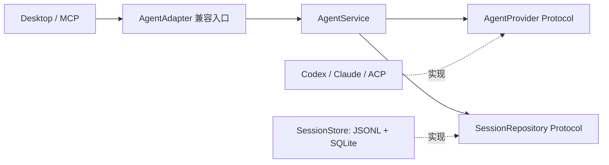

# Cleo 产品架构

[English](ARCHITECTURE.en.md)

本文面向集成方和贡献者，描述 Cleo 已实现的产品边界、运行时、harness adapter、session storage 与 memory pipeline。阅读后应能够判断一个请求由哪个入口处理、数据写到哪里、provider 如何扩展，以及哪些投影可以安全重建。

Cleo 的架构目标是：本地数据可控、不同 agent 体验一致、会话可以恢复、长期记忆可以回查证据。本文不把规划能力写成已完成能力。后端重构的设计过程与迁移步骤见 [后端架构 v2](refactor/BACKEND_ARCHITECTURE_V2.md)，各项决策的理由见 [ADR 索引](adr/README.md)。

## 产品上下文

```text
User
 ├── Cleo Desktop ── Electron/React ── JSONL IPC ─┐
 └── MCP client ── stdio ─────────────────────────┤
                                                   ▼
                                         Python application core
                                           ├── Cleo Chat → LLM API / 订阅 runtime
                                           └── Productivity → external harness
                                                   │
                                                   ▼
                                         local session + memory data
```

- 桌面端是唯一的图形入口。终端 CLI/TUI 与 Docker 运行方式已在 v0.8 移除，后端只作为桌面端的本地服务和 stdio MCP 入口运行；`tests/test_boundaries.py` 保证后端不再引入终端界面代码。
- Cleo Chat 使用配置的 chat model 或官方订阅 runtime；Productivity 通过 adapter 连接 Codex、Claude SDK 或 ACP agent。
- Cleo 不提供托管账户、远程数据库或 HTTP 服务。外部网络流量来自用户选择的模型、搜索、浏览器或 harness provider。

## 组件边界

```text
Electron main ── JSONL over stdio ── cleo.desktop.server
                                          │ rpc.py 方法表
                                          ▼
                                    DesktopService
                                          │ turn hooks → RunSupervisor
                                          ▼
                                     AgentSystem
                          ┌───────────────┴────────────────┐
                 内置 LangGraph 聊天 agent        AgentAdapter ── Codex / Claude / ACP
                          └───────────────┬────────────────┘
                                          ▼
                                    SessionStore
                     manifest.json · events.jsonl · compact.json · sessions.sqlite3
                                          │
                                          ▼
                              DreamAgent / 历史检索
```

- `cleo/bootstrap/container.py`：组合根。入口在这里显式加载配置并装配 `ConfigService`、`SessionStore`、`Runtime` 和 `DesktopService`，不依赖导入时的全局状态。
- `cleo/config/`：配置模型、加载逻辑和打包模板；`config/service.py` 提供带版本号的配置快照与热加载，一次运行绑定它开始时的快照。
- `cleo/desktop/server.py`：Electron 主进程使用的 JSONL stdio 协议服务；`desktop/rpc.py` 是协议的显式方法表，`tests/desktop/test_rpc_registry.py` 把它与 service 和 Electron 源码对账。
- `cleo/desktop/service.py`：桌面 use case 服务（工作区、线程、回合、设置）。运行中的回合由 `desktop/runs.py::RunSupervisor` 统一登记（每个线程至多一个，连同 steering、审批和工作目录占用）；回合前后的步骤是 `desktop/turn_hooks.py` 的 `TurnHook`；slash 命令在 `desktop/commands.py`。
- `cleo/desktop/agent_system.py`：会话绑定的是 agent system 而不是单个 agent。当前只有 `SingleAgentSystem`：聊天会话走 `desktop/chat_runtime.py` 的内置 LangGraph agent，开发任务走所选 harness。
- `cleo/desktop/projection.py`、`presenters.py`、`timeline.py`：把持久化状态投影成 renderer 契约；时间线索引是可重建的 SQLite 投影。
- `cleo/agents/cleo.py`：前台 Cleo Agent；`cleo/agents/dream.py`：后台记忆整理 Agent。两者可调用的工具集中在 `cleo/agents/tools/`。
- `cleo/harnesses/`：provider-neutral harness API、能力声明、控制面、审批与提问、session adapter。
- `cleo/integrations/harnesses/`：Codex、Claude 和 ACP provider 实现及 composition factory；`cleo/integrations/` 其余模块负责原生目录解析与迁移、订阅 runtime、模型目录、Git 与工作区。
- `cleo/sessions/`：`store.py` 组合 manifest（`manifests.py`）、append-only 事件日志（`event_log.py`）、全局索引（`index.py`）、增量 compact（`compact.py`）与回退（`rewind.py`）。
- `cleo/memory/`：compact projection、Markdown 项目偏好及其内嵌 Git、证据、跨来源读取、路径与 consolidation state。
- `cleo/runtime/`：`state.py` 保存界面导航状态；`usage.py`、`context_capacity.py` 负责上下文读数；`task_*.py` 负责任务用量台账；`timing.py` 负责回复计时。
- `cleo/routing/`：受约束的子任务路由，不改变协调会话的模型（见[子任务路由](benchmark-routing.md)）。
- `cleo/computer/` 与 `cleo/integrations/computer.py`：内置浏览器和本机电脑控制（见[电脑使用](computer-use.md)）。
- `cleo/mcp/`：stdio MCP 入口：`codex_server`、`memory_server`、`agent_server` 与 `computer_server`。

依赖方向保持为 `desktop → agents / harnesses / sessions / runtime / integrations`。session persistence 可以依赖 memory projection，但 session、memory 和 integrations 不反向依赖桌面入口；provider SDK 类型不泄漏到 `SessionStore` 或 renderer。

## Domain、application 与 infrastructure

保留按功能组织的目录，在模块层面区分职责：

| 层 | 模块 | 职责 |
| --- | --- | --- |
| Domain / contracts | `harnesses/models.py`、`control.py`、`provider.py`、`capabilities.py`；`sessions/ports.py`、`policy.py` | 会话与事件类型、provider / repository 接口、能力声明、无 I/O 的会话内容规则 |
| Application | `harnesses/service.py::AgentService`、`desktop/service.py::DesktopService`、`desktop/runs.py` | 创建、恢复、执行、取消和关闭会话；回合生命周期 |
| Infrastructure | `integrations/harnesses/`、`sessions/store.py`、`integrations/background.py`、`integrations/workspace.py` | SDK、JSONL / SQLite、后台进程、文件系统与 Git |
| Presentation | `desktop/projection.py`、`desktop/presenters.py`、`ui/src/components/` | 桌面呈现 |
| Composition / compatibility | `bootstrap/container.py`、`harnesses/adapter.py`、`integrations/harnesses/factory.py` | 构造具体实现并接入应用服务 |



这里的 `Protocol` 就是 Python 的接口契约：实现方只需提供约定的方法签名，不要求继承某个框架基类。`SessionRepository` 只包含 harness 用例实际使用的持久化操作，不暴露数据库连接或存储目录；`SessionStore` 继续负责现有磁盘格式和派生投影。provider 的可选能力由 provider 类声明（`harnesses/capabilities.py`），不要求所有 provider 实现 Codex 专属功能。

`AgentService` 不构造存储或 SDK。`AgentAdapter(project_root, ...)` 保留默认本地存储和 `register_acp` 便捷方法。新增核心逻辑应写进 service，新增具体 provider 的装配写进 factory。工作目录验证仍是应用服务的输入边界。

共享的事件 payload / usage 投影位于 `harnesses/events.py`，后台进程和工作目录操作位于 `integrations/`。前端的装配点显式返回 `CleoClient` 接口，由 IPC 和 mock 两个实现满足同一契约。

`agents/` 的 LangGraph 装配、memory persistence 和 `Runtime` 的 JSON 读写仍是具体实现，不能把整个 Python 包视为纯 domain。

## 安装与运行目录

源码 checkout：当 `cleo/config/settings.py` 能在源码根目录看到 `pyproject.toml` 时，相对目录以仓库根目录为基准。

桌面安装包使用分离布局（以 Windows 为例，其他平台见[平台支持](PLATFORMS.md)）：

```text
%LOCALAPPDATA%\Programs\Cleo\   # Electron 应用与启动器
%LOCALAPPDATA%\Cleo\            # config、data、memory、skills、workspace、runtimes
%USERPROFILE%\.codex\           # Codex 原生目录：登录、配置、会话、skills
%USERPROFILE%\.claude\          # Claude 原生目录
```

Electron 主进程通过 `CLEO_HOME` 明确指定数据根目录，并从包内 defaults 只补齐缺失文件。Codex 与 Claude 使用本机原生目录（`CODEX_HOME` / `CLAUDE_CONFIG_DIR` 优先），与原生客户端共用登录和历史；旧版 Cleo 专用目录的迁移规则见[配置说明](CONFIGURATION.md)。

程序版本的下载、切换、失败回退和保底入口由 Electron 侧的 `ProgramUpdates` / `ProgramVersions` 负责，只替换经过 SHA-256 校验的程序，不覆盖用户数据（见[程序版本与恢复](program-versions.md)）。卸载默认保留数据目录。源码 checkout 与桌面包的数据目录互不耦合。

## Space 与 Project

每个 session 都必须同时绑定：

```text
space + project + session_id
```

当前 space 为：

- `non_productivity`：Cleo 主聊天、个人上下文、长期偏好和一般计划。
- `productivity`：Codex、Claude、ACP 等 harness 的工程任务与执行记录。

同名 project 在两个 space 中仍然是不同的数据边界。SQLite 查询、compact 校验、DreamAgent 工具和 evidence 都必须携带 space，避免 productivity 内容自动进入个人记忆。跨空间读取只通过显式的检索工具发生（见[双向记忆读取](MEMORY_READING.md)）。

聊天中的 project 是可选的逻辑记忆边界，可表示一个长期话题、计划或工作流，并不要求存在代码目录；不关联项目的对话记在 `general` 下。开发任务把规范化 `cwd` 当成用户可见的项目身份；内部 session 的 `project` 字段仍用于 Cleo 侧记录分区，默认取工作目录名；harness 的真实代码边界始终由 `cwd`/仓库决定。

Cleo thread 的标题由首条 `user_message` 确定，也可作为纯 metadata 手动修改。活跃且尚未 consolidation 的 thread 可以迁移 project：session 目录、manifest、event 绑定、SQLite registry、compact、memory state 与 conversation chunks 会一起转移。一旦 source 已被 DreamAgent consolidation，迁移会被拒绝，以免旧 project 的长期记忆无法可靠回收。桌面端通过 `move_thread` RPC 和对话菜单的「加入项目…」暴露这一能力，`/project move <name>` 对聊天和开发任务同样可用：运行中、跨空间和带 harness 交接快照的任务会被拒绝并说明原因；开发任务迁移后 `cwd` 指向目标项目目录，驻留的 harness 会话关闭并在下一轮以新目录恢复，上一轮的 Git 撤销点被丢弃（[ADR 0002](adr/0002-move-conversation-into-project.md)）。

## Session 存储

```text
memory/
├── MEMORY_POLICY.md
├── sessions.sqlite3
├── non_productivity/
│   ├── memory.sqlite3
│   ├── memory_state.json
│   └── projects/<project>/
│       ├── MEMORY.md
│       └── sessions/<session_id>/
│           ├── manifest.json
│           ├── events.jsonl
│           └── compact.json
└── productivity/
    ├── memory.sqlite3
    ├── memory_state.json
    └── projects/<project>/
        ├── MEMORY.md
        └── sessions/<session_id>/
            ├── manifest.json
            ├── events.jsonl
            └── compact.json
```

### Manifest

`manifest.json` 是可变的当前状态投影，记录 title、provider、native session ID、owner、status、cwd、event sequence、source hash 和更新时间。更新使用临时文件加原子替换。

### Event Log

`events.jsonl` 是权威记录，只追加不覆盖。每行包含全局 event ID、严格递增 seq、space/project/session 绑定、actor、type、时间和 payload。

流式 token 只发送给实时调用者；完成后的语义消息才持久化。工具调用、权限、文件变化、计划、状态和错误以独立规范事件保存。大型输出应使用 `data/session_artifacts/`，event 只保存引用。

编辑一条较早的用户消息时，日志不删改原记录，而是追加一条 `rewind` 事件，`data.turn_id` 指向被编辑的回合。时间线、聊天历史恢复、harness 交接上下文和记忆压缩都会跳过从该回合到 `rewind` 之前的全部事件；seq 与 source hash 仍覆盖完整日志。

### Compact Projection

`compact.json` 是可重建派生层：

- 从 `events.jsonl` 读取 semantic events。
- 合并 tool call/result。
- 脱敏 secret 与大型参数。
- 省略低价值读取结果和超长终端内容。
- 保存 `source_content_hash`、event range 和 `source_event_ids`。

文件使用 v3 的不可变批次加可替换的尾部元数据，每轮只追加新增记录（见[开发指南](DEVELOPMENT.md#增量-compact-缓存)）。加载 compact 时校验范围、事件序号和文件版本；同版本复用有上限的验证记录，首次、变更或损坏时再读取完整事件并核对 hash。

### SQLite 与时间线索引

`memory/sessions.sqlite3` 是所有 session 的全局 metadata registry，可由 manifest 重建。每个 space 自己的 `memory.sqlite3` 保存 atomic memory、event evidence、consolidation 记录与 lexical conversation chunks。会话目录中的 `.desktop-timeline-v1.sqlite3` 是桌面时间线的可重建索引。SQLite 不是原始对话事实源。

加载工作区的开销不随历史规模增长：索引只增量读取追加事件，投影版本只在旧索引出错时提升（[ADR 0010](adr/0010-startup-cost-independent-of-history.md)）。

人格存储已退出运行路径。旧 `persona.sqlite3` 与 `PERSONA.md` 原样保留，不读取、注入、更新或自动转成项目偏好；旧 `persona_path` 配置在校验时忽略。

## 桌面回合流转

```text
renderer stream_turn
  → rpc.py 方法表 → DesktopService.stream_turn
  → TurnHook.check（拒绝不合法的回合）
  → RunSupervisor 登记运行，绑定配置快照
  → TurnHook.prepare（/computeruse、本地 skills 改写 prompt）
  → AgentSystem.run_turn → AgentRuntime.stream
  → canonical event → SessionStore 追加 events.jsonl
  → projection → emit 推回 renderer
```

运行期间输入的消息进入队列，可用 `steer_run` 送入当前回合（`desktop/steering.py`）；`cancel_run`、`resolve_approval`、`resolve_question` 作用于登记的运行。

## Harness 事件适配

不同 harness 的原生输出先在 provider adapter 中翻译：

```text
native provider event
    → provider-specific translator
    → Cleo canonical event
    → SessionStore
```

公共语义包括：

- `assistant_message`
- `tool_call` / `tool_result`
- `permission_request` / `permission_response`
- `question_request` / `question_response`
- `file_change`
- `terminal_output`
- `plan_update`
- `status` / `error`

无法稳定归一化的事件保存为 `provider_event`，并在 `data` 中保留 provider、原始事件类型和清理后的 payload。SessionStore 不依赖任何单个 harness 的 SDK 类型。

一次原生 result 不一定结束一个回合。Claude Code 可以在前台轮次结束后继续运行后台任务（`Bash(run_in_background=true)`、后台 agent），完成时在同一条流上唤醒模型再跑一轮。`ClaudeProvider.prompt` 以后台任务集合与 `task_notification` 的欠账计数判断回合真正结束：阶段边界记为 `status` 事件 `claude/stage_completed`，等待超时或取消时写 `claude/background_abandoned` 并以 `failed` / `cancelled` 终态结束；带 `ambient: true` 的任务不属于当前回合。service、投影与 UI 不需要知道这些 harness 特有语义。各 harness 的原生问答、审批、回合结束与后台任务协议，以及 Cleo 的适配方式，见[Harness 交互式问答与回合生命周期](harness/interactive-lifecycle.md)与 [ADR 0004](adr/0004-claude-turn-and-background-task-lifecycle.md)。

## Cleo 主聊天流转

```text
用户消息
  → Agent.stream_text
  → LangGraph state
  → 每轮结束同步新增 LangChain messages
  → SessionStore 追加 events.jsonl
  → 原子更新 manifest
  → 增量更新 compact.json
  → 更新 space-bound conversation chunks
```

恢复对话时通过全局 registry 找到 manifest，再从 message events 重建 LangChain messages。它不是 durable LangGraph checkpoint 恢复。

使用订阅连接的聊天由官方 runtime 执行（`cleo/agents/runtime.py`、`cleo/integrations/subscriptions.py`），凭据留在各厂商自己的登录存储中，见[订阅登录与 DreamAgent](SUBSCRIPTION_CHAT.md)。

## Harness 流转

```text
AgentAdapter.create_session
  → provider 创建 native session
  → productivity manifest + session_created

AgentAdapter.prompt
  → user_message + session_running
  → provider prompt
  → provider events 归一化
  → assistant_message + terminal status
  → compact + SQLite index

Codex rich control plane
  → thread/list + thread/read（只读浏览原生历史）
  → model/list + account/read（能力发现）
  → per-turn model / effort / sandbox / approval
  → thread/fork / name/set / compact / archive

AgentAdapter.rewind（编辑较早的用户消息）
  → Codex: thread/revert，移除该回合及之后的回合
  → Claude: 在该消息之前离线 fork 原生会话，并切换到新会话
  → rewind 事件 + 以编辑后的文本发送新回合
```

`session_<status>` 事件记录本回合的原生 turn ID，Codex 编辑时可直接定位；缺少记录时按提示文本从新到旧对齐原生回合。只有最近一次 harness 交接之后的回合可以编辑，ACP 任务不提供编辑。编辑只回退对话，不回退已写入工作区的文件。

provider factory 读取独立的 `config/harnesses.json`，注册启用的 Codex SDK、Claude SDK 或 ACP provider，并选择配置的 default provider。开发任务可以新建，也可以通过 Cleo session ID 恢复 native session。输入框中的 slash 命令（`/cwd`、`/cd`、`/model`、`/effort`、`/resume`、`/native`、`/resume-native`、`/fork`、`/compact` 等）在 `desktop/commands.py` 处理：`/native` 浏览原生历史时不写入 Cleo event log，只有 `/resume-native` 才创建或复用 Cleo handle ↔ native thread ID 映射。

每个 managed productivity thread 在 manifest 顶层保存 provider/harness，并在 `runtime_options` 中保存 model、reasoning effort、sandbox 与 approval mode。恢复 native session 时，`AgentAdapter` 会把这些选项重新应用到 provider runtime；只有用户显式修改运行参数时才更新该 thread 的已保存档位。切换 harness 的选择随下一条消息交接，交接上下文由 `harnesses/context.py` 与 `handoff.py` 生成并校验。

各 harness 的上下文读数都归一化为 `status` event：Codex 的 `thread/tokenUsage/updated`、ACP 的 `usage_update`，以及 Claude provider 按每次请求发布的 `cleo/context_usage`。`cleo/harnesses/events.py` 用同一口径投影它们：占用是最近一次请求放进窗口的输入（新输入、缓存读取、缓存写入），不含输出；窗口取 harness 上报的值。它驱动输入框旁的圆环。账号用量（`get_harness_usage`）在用户打开圆环面板时按需读取：Codex 走 `account/rateLimits/read`，Claude 走 CLI 的 `get_usage` 控制请求，读数复用 60 秒，读不到就不显示。见 [ADR 0011](adr/0011-one-context-measure-and-on-demand-account-usage.md)。

`AgentAdapter` 的通用数据面仍只负责 create/resume/prompt/cancel/close；Codex 特有的历史、模型与 thread 生命周期属于可选控制面，不强迫 Claude/ACP 伪造同名能力。已完成内容只留在 SessionStore；provider 连接关闭后不会常驻内存。

## DreamAgent 流转

```text
原始 events.jsonl → 带来源引用和省略标记的有界投影
  → 当前项目偏好 + 用户证据 → old/new 候选编辑
  → 按项跳过证据不足的冲突，保留其他有效编辑
  → 基于最新正文重新核对 → MEMORY.md 原子发布及 Git 提交
  → 发布可靠完成后推进 committed_seq 并清理 pending
```

两个空间都只抽取有用户证据的项目偏好。事实、代码和任务结果通过历史检索回查。项目 `MEMORY.md` 是唯一保存偏好正文的地方，变更由内嵌 Git 记录（见 [Markdown 记忆与迁移](MEMORY_MARKDOWN_GIT.md)）。

DreamAgent 使用 `active_profiles.dream_agent` 独立选择 `profiles.agents` 中的模型配置。旧配置未设置该字段时回退到前台 `active_profiles.agent`。

后台整理在桌面进程内按批次顺序执行（`desktop/background_memory.py`），由时间间隔或待整理来源数量触发，可取消；默认关闭，关闭时仍可手动整理。失败的来源按有界退避自动重试，也可从队列手动重试（[ADR 0001](adr/0001-retry-failed-memory-sources.md)）。自动 consolidation 不会修改 `AGENTS.md`，也不会创建或更新 skill。整理开关独立于只读记忆查询与托盘驻留；关闭后停止新模型调用，取消与重启通过现有 pending/checkpoint 恢复。

用户确认整理后，DreamAgent 直接处理 validated compact；手动忽略则只记录 `processed_hash` 和 skipped 状态。`consolidated_hash` 只表示 source 已完成项目记忆协议，因此被手动忽略的 thread 仍可按未 consolidation 的规则迁移 project。

## Runtime State

`data/runtime.json` 只保存界面状态：

- `ui_language`
- `current_space`
- `current_project`
- `current_thread_id`
- 按 space 分区的 projects
- 按 space 分区的 recent threads

它不保存对话正文，也不是 session registry。

## 扩展点

### 新增 Productivity provider

实现 `AgentProvider` 的 create/resume/prompt/cancel/close 契约，在 provider 内完成 native event 到 canonical event 的转换，在 provider 类上声明能力，再通过 factory 注册配置类型。只有真正跨 provider 共有的能力才进入 `AgentAdapter`；历史、模型枚举或 thread 管理等专属能力应放在可选 control plane。

### 新增桌面协议方法

在 `DesktopService` 上实现同名方法，并在 `desktop/rpc.py` 的方法表中登记调用方；renderer 可调用的方法还要进入 `ui/electron/main.mjs` 的允许列表。对外协议必须明确流式事件、取消、错误、shutdown 和 secret DTO 的边界。

### 新增记忆投影

投影只能从 validated compact 或权威 event log 构建，必须绑定 space/project/session 与 source hash。投影失败不得回写或修改原始 event log。

## 当前部署边界

- 桌面发布包面向 Windows x64、macOS Apple Silicon / Intel 和 Linux x64；Linux ARM64 与 Windows ARM64 没有原生包。
- 应用按本地单用户模型设计，没有多租户身份、远程同步或服务端授权层。
- `events.jsonl` 只有单 session append writer 的假设；外部工具不应并发直接修改运行文件。
- provider 能力存在差异，UI 必须根据 capability 降级，而不是假设所有 harness 等同于 Codex。
- 自动记忆是可审计的辅助信息，不替代原始会话或用户确认。

部署与安全默认值见[配置与安全边界](CONFIGURATION.md)，开发验证见[开发与发布](DEVELOPMENT.md)。
