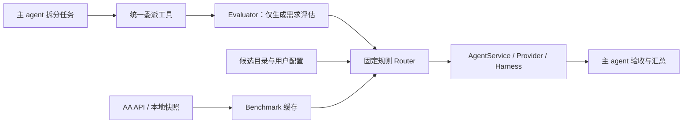
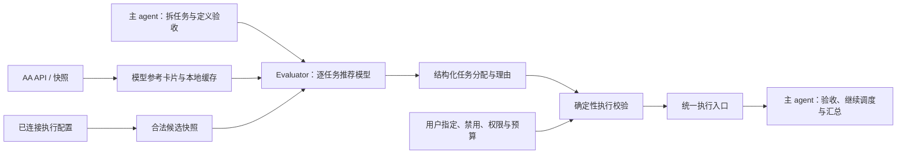

# Cleo 子任务模型路由：现状与改进计划

日期：2026-10-21。状态：以下保留实施前的现状分析；v2 已实现，运行行为与限制见 [路由使用文档](benchmark-routing.md)。第三次修订取消 token 预测，仅增加两种 agent 模式下的当前任务累计实际 token；保留相对排名与反馈更新闭环。

本文基于当前仓库及本机已安装的 `v0.10.0 · 模型兼容性修复 4` 核对。后续已按批准的四批实施，保留本段作为原始诊断基线；开发和交付验证不发送付费推理请求。

## 1. 目标与职责

用户期望的核心流程是：**先确认可用模型 → 从 Artificial Analysis 获取/读取这些模型的成本与能力资料 → 建立内部相对排名 → 主 agent 拆任务、evaluator 分配模型 → 校验与执行 → 记录 token、验收及用户反馈 → 有界更新本地排名。**

新增设计详见 [排名、任务 token 与反馈更新方案](subtask-routing-feedback-and-token-plan.md)。这次明确增加了基于反馈的本地排序更新，替代最早“记录只用于观察、不更新规则”的范围限制；仍不训练模型，不修改 AA 原始分数，不自动做多模型对照实验。

Artificial Analysis（AA）提供模型参考资料；它不执行 Cleo 的任务，也不替 Cleo 决定选谁。Evaluator 是一个可配置模型承担的决策角色；它可以使用已有 API 或 harness 连接，未单独设置时沿用“新对话默认连接和模型”。

主 agent 保留是否委派、任务边界、依赖、并行时机和最终验收权。Evaluator 推荐执行组合及理由，不能改变权限、增加连接或绕过用户禁用项。执行组合仍是 `connection + harness/backend + model + reasoning effort`。

## 2. 当前真正的结构



### 2.1 代码与实际行为

| 环节 | 当前实现 | 实际职责 |
|---|---|---|
| 主协调者 | `cleo/agents/cleo.py`、`cleo/agents/runtime.py` | API 主模型或 harness 主模型理解请求、调用工具、拆分和汇总 |
| 委派入口 | `cleo/routing/tools.py`、`cleo/agents/tools/codex_tools.py`、MCP 注册入口 | `route_subtask` 预览、`delegate_subtask` 执行；旧 `codex` 工具可进入统一路由 |
| 服务编排 | `cleo/routing/execution.py::RoutingService` | 读取候选、调用 evaluator、调用 router、执行、取消、记录和有限升级 |
| Evaluator | `cleo/routing/evaluator.py::SubtaskEvaluator` | 输出 `TaskAssessment`；不接收候选和 AA 数据，也不输出模型分配 |
| 候选目录 | `cleo/routing/catalog.py`、`cleo/harnesses/availability.py` | 连接、模型、推理档位、工具能力、账号支持信息及失败证据 |
| Benchmark | `cleo/routing/benchmarks.py` | 官方数据接入、导入、缓存和模型变体匹配；委派时只读缓存 |
| 选模型 | `cleo/routing/router.py::route` | 硬约束过滤、人工档位、可比较 benchmark 排序或配置的固定回退 |
| 统一执行 | `cleo/harnesses/service.py`、现有 provider | 复用 session、事件、取消与具体 harness 执行 |
| UI | `ui/src/components/Conversation.tsx`、`model-settings/RoutingSettingsPanel.tsx` | 切换模式、配置候选、评估器、benchmark 和查看最近记录 |

### 2.2 已验证的设计差异

1. **Evaluator 没看到 AA 资料。** 离线探针捕获它实际收到的字段，仅有 `subtask`、`coordinator_assessment`、`output_schema`。要求其收到候选与 benchmark 的设计一致性断言失败，复现了这次反馈；探针使用 fake completion，没有真实推理。
2. **Evaluator 当前不能选模型。** 提示词明确禁止 `choose providers`，输出格式只允许描述需求，不含 `candidate_id` 或逐任务分配。
3. **Router 的人工档位比 benchmark 更靠前。** 复杂度先映射 economy / balanced / strong，排序首先考虑档位差，再考虑质量、成本或速度。它没有逐项分析“这个任务为什么值得用这个模型”。
4. **缺失数据容易让不同任务使用同一回退。** 当前可比较评分要求合格候选都有匹配数据，且评测族与版本一致；未满足或所选偏好缺少可靠估算时，通常使用配置的固定回退。这符合此前的保守规则，但不符合现在希望的 evaluator 分配方式。
5. **主模型本身可能在路由前失败。** 当前会话必须先成功响应、拆任务并调用委派工具，才会进入子任务 evaluator。自动路由不会替换当前会话的主模型。
6. **界面将两种信息混在一起。** `子任务路由 · gpt-6.1-sol` 中的模型来自 `runtime.model`，仍是当前协调者，不是 evaluator 为某个子任务选出的执行模型。

主模型也可以通过工具查看候选并显式指定执行组合，但这并不等于独立 evaluator 已经依据 AA 自动决策。

## 3. 关于截图里的 unsupported

能确认的事实：

- 报错表示**这次请求使用的 Codex 执行路径与 ChatGPT 登录组合拒绝了 `gpt-6.1-sol`**。不能扩大为“6.1 Sol 模型不存在”或“所有账号都不支持”。
- 本机 Cleo 包内的 Codex CLI 是 `0.157.1`；当前 Codex 桌面端的 CLI 是 `0.163.0-alpha.11`。两者不是同一个客户端运行环境。
- Cleo 使用自己的隔离 harness 登录和配置目录，不能直接把另一个应用中的可选模型视作 Cleo 已获支持的模型。
- 官方文档列有 `gpt-6.1-sol`，并在 ChatGPT 登录推理文档中使用该名称；是否可用于具体账号和执行路径仍须以当前目录与该路径的兼容性为准。

**尚未确认**：拒绝究竟由旧 CLI、登录凭据范围、具体账号开放范围还是服务端路由差异引起。只检查了版本和代码，没有发送模型请求来“试一下”。

上一版修复解决了重复选择失败组合的问题，没有完成上述兼容性根因定位。后续应把失败记录范围扩展到实际 runtime/backend 版本，避免升级 CLI 或更换运行路径后，旧拒绝记录仍被当作永久的账号结论。

后续诊断顺序：同一个 Cleo 隔离登录下，对比两个已安装 CLI 的只读目录；核对真实执行使用的二进制、登录方式和 endpoint 类型；检查模型目录是否陈旧；确认 SDK/CLI 兼容后再讨论升级。不得直接换成桌面端二进制、复制另一账号凭据或运行付费探测。

## 4. 目标架构

以下为基础目标架构；排名、任务实际用量和反馈的修订流程见 [反馈与用量方案](subtask-routing-feedback-and-token-plan.md)。



变化集中在一个边界：**Evaluator 提出有依据的模型分配；确定性模块负责确认这项分配可以执行。** 保留规则用于硬约束和明确回退，不再让固定档位排序充当主要的任务分配者。

### 4.1 五类数据

| 数据 | 内容 | 来源与可信边界 |
|---|---|---|
| `SubtaskSpec` | task_id、目标、依赖、必要上下文、工具能力、验收标准、预算/截止时间 | 主 agent 生成；权限和用户硬约束由宿主绑定，评估不能放宽 |
| `ExecutionCandidate` | connection、backend、runtime 版本、model、effort、支持状态和用户启用状态 | 现有候选目录；只有满足硬约束的候选可被分配 |
| `ModelReference` | AA 能力分项、参考价格、速度、延迟、数据时间、评测族/版本、匹配程度 | 本地缓存；是参考事实，不是权限或任务成功概率 |
| `EvaluationDecision` | 每项任务的 candidate_id、理由、证据引用、替代项、估算和不确定性 | 所选 evaluator 的结构化建议；所有 ID 和证据须经校验 |
| `ExecutionRecord` | 推荐、校验、最终执行、attempt、用量、实际成本、失败与独立验收状态 | 正常执行产生；不重复跑任务来采集数据 |

Evaluator 和子任务 worker 都只接收必要信息。不能为分配一个小任务反复传整个会话、仓库或完整文件。

### 4.2 AA 如何参与决策

1. 进入子任务路由流程时，先由宿主确认可用模型。缺少有效 AA 缓存时，在配置与配额允许下请求数据，建立参考卡片和排名；有效缓存直接复用。保留手动刷新和导入，不为每项子任务重复请求榜单。
2. 将模型与 AA 记录关联，区分：精确版本/推理档位匹配、模型系列参考、未匹配。模糊系列资料可以作为明确标注的定性参考，不能伪装成该执行变体的精确评分或报价。
3. 分开存储实际模型版本、评测指数版本、coding-agent 所用 harness 版本；这些版本不能混成一个 `version`。
4. 为每个合格候选生成简洁参考卡片。缺失项保持 unknown，过期项附时间；不要求所有模型都有完整评分，才让任何 AA 信息生效。
5. Evaluator 根据任务类型参考相关能力分项，并解释质量、预计消耗和时延的取舍。不能机械地用最高综合分解决所有任务。
6. API 价格、订阅额度、AA 参考成本与 Cleo 实际账单分开。对订阅 harness，AA 的 token 价格只能标为 API 参考/代理信息；不能据此声称本任务实际花费某金额，也不能把订阅当零成本。

数据不足时，evaluator 可以依据已知工具能力、明确的人工辅助档位和保守偏好提出低置信度建议，并说明缺了什么。若 evaluator 未能形成有效建议，才进入配置允许的确定性回退；不能因某一个候选缺分数就把所有子任务送给同一个模型。内部保留按任务类型划分的相对能力、成本及速度排序，AA 基线与本地反馈修正分开呈现。

### 4.3 Evaluator 如何选择

- 默认沿用新对话默认连接/模型；用户可独立选择已有 API 或 harness 模型。这是角色选择，不是新接入一个模型供应商。
- 如 evaluator 与主协调模型相同，主模型先取得候选和参考快照，在正常拆分中直接产生结构化分配，避免再调用一次相同模型。只有一个需求评估、没有候选/证据关联的旧结果，不能标记为已完成新式分配。
- 如独立指定 evaluator，对主模型已经拆好的一个有界任务批次调用一次，返回逐任务分配。建议首版最多 8 个子任务；更大的计划由主模型分批，而不是无限增加评估上下文。
- Evaluator 不改写任务依赖，不决定并行启动，不直接调用 worker。主 agent 可以要求重新评估或明确改选，但改选同样须通过宿主约束校验。
- 用户显式指定执行模型/harness 时，优先校验并遵循。不可用则解释，不能静默换选。

提议的输出契约示例（不是现有 API，也不是已生效配置）：

```json
{
  "context_id": "ctx-example",
  "assignments": [{
    "task_id": "task-1",
    "candidate_id": "connected-harness/model@effort",
    "reason": "改动局限在文档；必要能力已满足，优先节省资源。",
    "evidence_refs": ["candidate-card-1", "aa-record-1"],
    "alternatives": ["another-connected-candidate"],
    "estimated_input_tokens": null,
    "estimated_output_tokens": null,
    "uncertainty": "medium",
    "missing_data": ["subscription_quota_remaining"]
  }]
}
```

不输出未经校准的成功概率。验收标准属于任务，不能由 evaluator 为了选择便宜模型而降低。

### 4.4 确定性校验与执行

执行前重新校验连接/账号/runtime、用户禁用项、精确模型与 effort、工具/模态、上下文、预算能力、截止时间和宿主权限。检验 evaluator 引用的候选与 benchmark 证据是否真的存在，防止虚构分数和模型名。

每项分配绑定 `context_id`、配置修订及快照摘要。过期或配置变更后拒绝旧选择并返回可解释的重新评估请求。不能在后台悄悄替换 executor。

主 agent 决定何时执行 `delegate_subtask`，执行层复用现有 AgentService、session、事件与取消。首版只沿用已具备的 Codex、Claude 和可发现能力的 ACP 路径；已有 API 可用于 evaluator。直接 API worker 若需执行工程任务，必须具备完整工具执行 runtime，作为后续独立范围，不能把“有 API key”当“已有 coding harness”。

### 4.5 失败与有限重新分配

| 情况 | 后续行为 |
|---|---|
| 模型/effort 明确不支持 | 排除对应执行组合，记录真实 runtime 范围；不重放同一组合，不简单升级为更强模型 |
| 认证、网络、额度或工具错误 | 返回连接/基础设施问题；按已有安全恢复策略处理，不降低或提高能力档位来掩盖问题 |
| 上下文不足、任务不清 | 主 agent 补充上下文或拆探索任务，再评估 |
| 实现或推理未通过可信验收 | 主 agent 可要求 evaluator 推荐替代；默认最多一次自动重新分配，检查已有改动、工具副作用与剩余预算 |
| 用户取消 | 结束执行和评估链路，不自动重试 |

只有已有可信测试、产物检查或用户确认才能标记验收通过；模型自述完成仍记录 `acceptance: unknown`。

## 5. 四批实施与验收

批次顺序：一 → 二 → 三 → 四。每批都可独立评审；第四批以前不将新策略设为默认。以下是后续计划，本次不实施。

### 第一批：拆清主模型、路由模式和运行兼容性

**工作：**

- T1：分别显示“执行模式 / 主协调模型 / evaluator”。子任务模型在每项委派卡片上显示，不再拼在主模型标签中制造歧义。
- T2：统一主模型与子任务的支持状态来源；补充实际 runtime/backend 版本、登录类型和安全的连接身份摘要。
- T3：定位 `gpt-6.1-sol` 在两条本地路径中的目录与兼容差异。修正拒绝记录作用域及失效/重查规则；明确拒绝、元数据未知和 CLI 兼容性问题使用不同状态。升级或重新登录后只读复核，不付费探测。
- T4：同一次 run 的错误只展示一次，优先展示可操作的中文说明，原始错误按需展开。保留已有会话模型，不静默换掉它。

**主要改动位置：** Conversation、desktop presenters/service、harness availability/control、Codex 集成和 provider factory。暂不改进化控制器。

**验收：** fake CLI 的版本目录差异、同账号不同 runtime、账号切换、重新登录、未知目录、不支持 effort、重复错误事件；手动模式和主模型保持不变；无真实推理。

### 第二批：把 AA 缓存变成 evaluator 可消费的参考资料

**工作：**

- T5：复用 BenchmarkCache，整理 ModelReference/ReferenceCard，不复制 AA provider 或密钥逻辑。
- T6：建立模型匹配层，支持精确、系列参考、未匹配三种证据；保留人工校准解决歧义的入口。分离模型版本与评测版本。
- T7：先确认可用模型，按缓存策略取得 AA 数据；建立按任务类型的内部多维排名。抽取现有 router 的硬约束过滤，生成有界的 `RoutingContext`，包含合法候选、AA 参考、排名、用户偏好、原任务约束、数据时间与修订摘要。

**验收：** 无 key、空缓存、过期、刷新失败、部分模型缺指标、版本/effort 不匹配、不同指数不可混算、订阅成本未知；密钥不进入上下文或前端；有效缓存不重复请求，普通页面读取无外部刷新副作用，流程初始化的刷新有界且不调用推理。

### 第三批：让 evaluator 输出真实的逐任务分配

**工作：**

- T8：在现有只读 evaluator transport 上增加结构化推荐能力，输入 RoutingContext，输出 EvaluationDecision。保留 TaskAssessment，不把需求评估和模型选择混成未经校验的自由文本。
- T9：实现主模型复用与独立 evaluator 有界批量调用；默认 evaluator 继续跟随新对话默认设置。
- T10：把 `route()` 拆成可复用的过滤/校验与明确回退。新策略下 evaluator 提供推荐，执行层复核；旧规则策略可通过配置保留，便于回滚。
- T11：接入 `route_subtask`、`delegate_subtask`、旧 codex 委派适配和 MCP 入口，使用相同的宿主约束。预览不调用 evaluator；真实评估调用只发生在实际委派需要时。
- T16：建立用户反馈、任务重开和可信验收的关联；区分选模、拆分、交接、需求变更及环境原因。反馈立即进入证据记录，确定性更新器按有界、可撤销的策略更新本地排序；用户可关闭更新或恢复基线。

**验收：** 使用 fake evaluator 与本地 AA fixture，证明相同候选下文档任务与复杂修复可以得到不同分配，且引用相应数据；虚构候选/分数、越权推荐、超预算、旧快照、显式指定、取消和无效输出全部受控。断言“AA 参考实际进入 evaluator 输入”，不是只测 parser 返回成功。新增“同一问题反复未修好”“新增需求”“证据撤销”“重复事件”“新模型版本”用例，确认只更新正确范围的排名。

### 第四批：可解释 UI、完整记录和本地交付

**工作：**

- T12：每个子任务展示推荐者、实际 executor、选择理由、AA 参考分项及时间、缺失信息、估算、运行状态和独立验收状态。
- T13：默认展示模型与用户排除项；人工档位收进高级设置，作为数据缺失时的辅助信息。分开呈现 evaluator 失败、执行配置不支持和子任务实现失败。
- T14：记录 evaluator、验证、执行、反馈及排名修订的关联 ID；不新增完整 prompt/敏感文件日志，不训练模型，不自动放宽权限或硬约束。
- T15：完成全量回归、安装包离线链路检查；后续按用户明确安排通过进化应用并保存，更新侧栏配置预览。核对主模型、评估器、凭据和伴随窗口行为。
- T17：在上下文侧栏新增“当前任务累计 token”，与现有上下文占用分开。指定 harness 模式统计当前任务所有轮次；子任务路由模式汇总主协调者、evaluator、子任务、失败和返工。未上报显示未知，不增加预测、默认模型对照或节省百分比。
- T18：取消，不实施默认模型 token 预测及相关 UI、数据字段和估算器。

**验收：** API/harness 主模型都走统一委派入口；关闭自动路由后原流程正常；同模型协调者复用不多调用，独立 evaluator 每批调用次数有界；失败最多一次安全重新分配；取消不重试；验收 unknown 保留。两种 agent 模式都显示当前任务累计 token，覆盖累计/增量去重、缓存及推理 token 不重复相加、恢复与取消、切换执行模式、未上报和不同任务隔离。全部使用 fake provider/local fixture，不把离线通过描述成真实账号推理验证。

## 6. 迁移边界与完成标准

保留并复用：现有连接、AA 安全配置和缓存、候选目录、统一执行器、session/事件/取消、验收检查及记录。主要替换的是“谁决定模型分配”以及 evaluator 的输入输出，不重写整个 agent 系统。

提议新增策略开关 `strategy: rules | evaluator`，名称待实施时按既有结构确定。迁移先保留 rules 行为；evaluator 策略经过离线验收后，再按用户意愿启用。现有主模型、evaluator 选择、手动排除项、权限和 API key 不自动重置。

完整目标达到时，用户能清楚回答：

1. 哪个模型在协调、哪个模型在评估？
2. 这个子任务交给了哪个已连接执行组合，为什么？
3. 参考了哪份 AA 能力/价格数据，哪些数据仍未知？
4. 选择是否通过账号、runtime、工具和预算校验？
5. 实际执行和独立验收分别是什么结果？
6. 当前任务全部参与者累计用了多少 token，哪些用量缺失；指定 harness 和子任务路由模式均可查看？
7. 用户反馈影响了哪个任务类型/执行组合的排名，依据是什么，如何撤销？

不承诺数学意义上的“绝对最优”，而是做可解释、可约束、可检查的质量/消耗/耗时取舍。

## 7. 本次核对依据

- 离线输入捕获：`tests/.tmp-routing-audit-20261021/test_evaluator_contract.py`；1 个设计一致性断言失败，说明当前 evaluator 未接收候选与 benchmark。这是诊断探针，不是已实现新架构的验收结果。
- 当前已安装版本及两个 Codex CLI 版本均为本机只读检查；没有创建模型 turn。
- 现状/目标两张架构图为本次文档产物，目标图明确是设计提案。
- 本次未执行上述实施批次，未修改运行代码、现有配置、AGENTS.md 或技能，未构建或重装客户端。

官方参考：[AA Data API](https://artificialanalysis.ai/data-api/docs)、[GPT-6.1 Sol](https://developers.openai.com/api/docs/models/gpt-6.1-sol)、[ChatGPT 登录模型目录及推理](https://developers.openai.com/siwc/token-sharing-open-source/models-and-inference)。官方目录文档同时提醒 app-server 的列表可能来自内置或缓存目录，不能用另一个客户端的可选项推断当前执行路径的权限。
